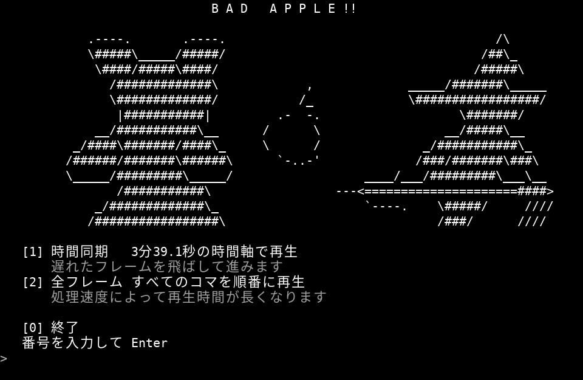

# Bad Apple!! ERB

**Bad Apple!! の影絵映像を、79桁×24行の文字画面として計算して再生します。**

起動時の AA 付きメニューから、経過時間に合わせる「時間同期」と、すべてのコマを表示する「全フレーム」を選べます。両方式は同じ `PLAYER.ERB` に入り、同じ座標・明度の数値モデルを使います。

[日本語の操作説明](runtime/README_ja.md) · [English instructions](runtime/README_en.md) · [仕組みの解説](runtime/HOW_IT_WORKS_ja.txt) · [Release notes](docs/RELEASE_NOTES_ja_en.md)



## ダウンロードと起動

このリポジトリの **Releases** から、使用する環境に合ったファイルをダウンロードしてください。Windows・Linux の実行用パッケージには PyPy を同梱しています。

| Release asset | 内容 |
|---|---|
| `BadAppleERB_79x24_menu_win64_PyPy.zip` | Windows x64向け。PyPy 同梱 |
| `BadAppleERB_79x24_menu_linux64_PyPy.tar.gz` | Linux x86_64向け。PyPy 同梱 |
| `BadAppleERB_79x24_menu_source.zip` | 生成用スクリプト、参照データ、実行用ファイルを含むソース一式 |
| `BadAppleERB_79x24_menu_verification.json` | 再構成・再生処理などの確認結果 |

アーカイブはフォルダーごと、書き込み可能な場所へ展開してください。端末は **80桁×25行以上**にし、24ビットカラー、ANSI の画面制御、日本語を表示できる等幅フォントを使用します。本編はその中の79桁×24行を使います。

### Windows x64

展開したフォルダーの **`BadAppleERB.cmd`** を起動します。同梱 PyPy が選ばれるため、Python の別途インストールは不要です。

起動スクリプトと `console_utf8.py` が、コンソールの入出力と Python の標準ストリームを UTF-8 に設定します。終了時には、変更したコンソールの入力・出力コードページを元へ戻します。日本語が文字化けする場合は、**同じ配布版の `BadAppleERB.cmd` と `console_utf8.py` を一緒に展開し、`BadAppleERB.cmd` から起動**してください。

### Linux x86_64

展開したフォルダーを UTF-8 の端末で開き、実行します。

```sh
sh ./run.sh
```

Windows 版は Windows UCRT と Microsoft x64 Visual C++ ランタイム、Linux 版は glibc 2.28以上を使用します。詳しい条件やトラブルシューティングは[日本語の操作説明](runtime/README_ja.md)にあります。

## メニュー

半角数字を入力し、Enter で決定します。

| 入力 | モード | 動作 |
|---|---|---|
| `1` | 時間同期 | 経過時間から対象フレームを選び、遅れたコマを省略して進む |
| `2` | 全フレーム | 全6,573コマを順番に計算して表示する |
| `0` | 終了 | プログラムを終了する |

再生後は自動的にメニューへ戻り、繰り返し再生や方式の切り替えができます。空入力や対象外の番号は再入力できます。再生中に終了するには Ctrl+C を押します。

時間同期の目標時間は **219.100秒（3分39.1秒）**です。最終フレームは表示します。終端直前の計算・表示が終端時刻をまたぐ場合は、その処理に必要な分だけ超過することがあります。

全フレームでは、30 fps の予定時刻より早ければ待機し、遅れてもコマを省略しません。そのため、処理性能によって再生時間が長くなります。最初のデータ読み込みとメニューの操作時間は、映像の時間に含みません。

## 映像の仕様

| 項目 | 値 |
|---|---|
| 表示領域 | 79列×24行 |
| 必要な端末サイズ | 80列×25行以上 |
| 階調 | 0～255の256階調 |
| 映像の時間軸 | 30 fps、6,573フレーム、219.100秒 |
| 表示文字 | 半角の `#` と空白 |
| 音声 | なし |
| 同梱処理系 | PyEmuera 3.0.0、PyPy 8.0.1（Python 3.12.15） |

元動画を固定条件で79×24セルに縮小し、横方向の区間を時間に沿って追跡した数値モデルを用います。再生時には、各区間の左端・右端・明度を整数式で求め、色付きの `#` と空白から各行を組み立てます。通常の再生に元の MP4、FFmpeg、NumPy は不要です。

一致の基準は、縮小後の79×24セルの明度です。端末での見た目にはフォントの字形、行間、文字セルの縦横比が影響します。元映像の4:3に近づけるには、文字セルの高さを幅の約2.47倍にするのが目安です。詳しい生成方法と両再生方式は [HOW_IT_WORKS_ja.txt](runtime/HOW_IT_WORKS_ja.txt) にまとめています。

## ソースから実行する

Python 3.10以上を用意し、リポジトリの `runtime` ディレクトリーで起動します。

```sh
cd runtime
python -B console_utf8.py PyEmuera.pyz .
```

Linux で Python のコマンド名が `python3` の場合は、`python` を `python3` に置き換えてください。生成用の依存パッケージは通常の再生には不要です。

実行用パッケージで CPython を選ぶ場合は、Windows では `BadAppleERB_CPython.cmd`、Linux では次を使えます。

```sh
PYEMUERA_PYTHON=python3 sh ./run.sh
```

`PYEMUERA_PYTHON` には実行ファイル名またはパスだけを指定します。追加のコマンドライン引数は含めません。PyPy の Python 3.12 実装は上流で beta と位置づけられています。

数値モデルの再生成については、[詳しい解説の「生成ソースと再生成の手順」](runtime/HOW_IT_WORKS_ja.txt)を参照してください。Releases のソース一式に含まれる参照配列から再生成する場合、元の MP4 と FFmpeg は不要です。

## ドキュメントと構成

| ファイル | 内容 |
|---|---|
| [runtime/README_ja.md](runtime/README_ja.md) | 日本語の操作説明とトラブルシューティング |
| [runtime/README_en.md](runtime/README_en.md) | English usage and troubleshooting |
| [runtime/HOW_IT_WORKS_ja.txt](runtime/HOW_IT_WORKS_ja.txt) | 数値モデル、文字列の生成、両再生方式の詳細 |
| [runtime/HOW_IT_WORKS_en.txt](runtime/HOW_IT_WORKS_en.txt) | Numerical representation, rendering, and playback scheduling |
| [docs/RELEASE_NOTES_ja_en.md](docs/RELEASE_NOTES_ja_en.md) | 日英のリリースノート |
| `runtime/` | ERB、数値データ、エンジン、起動スクリプト |
| `extract_reference.py` | 元動画から79×24の参照配列を抽出 |
| `compiler_geometry.py` | 参照配列から区間の位置・明度の数値モデルを生成 |
| `pack_geometry.py` | 共有係数と配布用数値データを出力 |
| `baseline/` / `validation/` | 再構成・再生・メニュー・UTF-8 起動の検証コードと記録 |
| `bundle_release.py` | 記録済みハッシュを照合して、PyPy 同梱版とソースアーカイブを作成 |
| [docs/BUILD_RELEASES.md](docs/BUILD_RELEASES.md) | 配布アーカイブの再構築手順 / Rebuilding release archives |

## ライセンスとクレジット

本プロジェクトで作成したコードのライセンスは [LICENSE](LICENSE) を参照してください。元映像および動画由来のデータ、PyEmuera、PyPy などの出典とライセンス上の扱いは [CREDITS.md](CREDITS.md) に記載しています。動画由来のデータと同梱コンポーネントは、それぞれの権利・ライセンスの対象です。

## English

Bad Apple!! ERB calculates and plays the silhouette animation as a **79-column × 24-row grayscale image** inside a terminal of at least **80 columns × 25 rows**. Both playback modes share one `PLAYER.ERB` script and the same numerical model. The movie has **6,573 frames at 30 fps**, with a **219.100-second** timeline. There is no audio.

Download the appropriate **PyPy bundle from Releases** and extract the complete archive. On Windows x64, run `BadAppleERB.cmd`. On Linux x86_64, run `sh ./run.sh`. The bundles include the Python interpreter. Use a terminal with 24-bit color, cursor control, UTF-8 support, and a monospaced font with Japanese glyphs.

Type a number and press Enter:

- **`1` — Time-synchronized:** selects frames from elapsed time and skips obsolete frames when processing falls behind.
- **`2` — All frames:** calculates and displays every frame in sequence, allowing playback to take longer when processing is slow.
- **`0` — Exit.** Playback returns to the menu automatically; Ctrl+C interrupts the program.

The Windows launcher configures UTF-8 through `console_utf8.py` and restores the changed console code pages afterward. Keep the launcher and helper from the same package together. The final movie frame is displayed in time-synchronized mode; work that crosses the end boundary can extend playback by the processing time required to finish.

To run the repository with an installed Python 3.10 or later, enter `runtime/` and run `python -B console_utf8.py PyEmuera.pyz .`. Use `python3` if that is your interpreter's command name. Normal playback does not require the original MP4, FFmpeg, or NumPy.

See [README_en.md](runtime/README_en.md) for full setup and troubleshooting, and [HOW_IT_WORKS_en.txt](runtime/HOW_IT_WORKS_en.txt) for the numerical representation and scheduling details. [LICENSE](LICENSE) covers project-authored code; [CREDITS.md](CREDITS.md) describes the original video, video-derived data, and upstream components.
